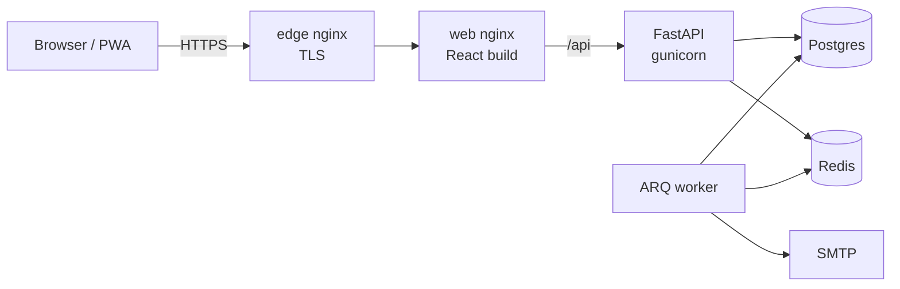
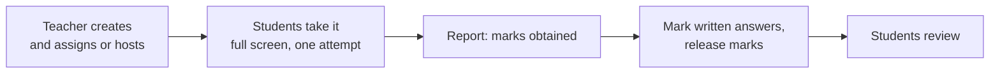

# OpenQZ

Open-source quiz and assignment platform for Don Bosco Institute of Technology, built by the Open Source Students Club (OSSC). Faculty create activities, assign them to sections or students, and students attempt them on their phones or laptops. It installs as a PWA.

**Status:** feature complete for v1.0 (Sprints 1 to 4 and hardening). Remaining: pilot, staging on the CSE server, release. See [docs/backlog.md](docs/backlog.md).

## What it does

- **Admins** import students, faculty and teaching assignments from the office sheets (CSV / Excel), print login slips, manage accounts, and see audit and integrity logs.
- **Faculty** build quizzes, assignments, polls and flashcards (6 question types, images, timers, marks, rubrics) for the classes they teach, picking **branch, semesters and sections**. They assign them to classes or **host a room** with a 6-digit join code, mark written answers, see **marks obtained** per student and per question (overview grid), and export to Excel or CSV.
- **Club organisers** build activities and host rooms (tech fests, events) that any signed-in student can join.
- **Students** sign in with email or Google, join with a code, take timed quizzes one question at a time on their phones (one attempt each), get instant feedback when allowed, and review their marks.
- Exam integrity: full screen required (per assignment), tab or app switches, Back and reloads are counted, with auto-submit at the teacher's limit; the teacher can **unblock** a student. Timers are enforced by the server.
- Layout and flows follow Wayground (formerly Quizizz), with OpenQZ's own branding and no AI features.

Documentation index: [docs/README.md](docs/README.md). User guides: [student](docs/guides/student.md), [faculty](docs/guides/faculty.md), [admin](docs/guides/admin.md).

## Stack

| Layer | Tech |
| --- | --- |
| API | FastAPI, SQLAlchemy 2 (async), Alembic, Pydantic v2, PyJWT, Argon2 |
| Jobs | ARQ worker on Redis (imports, emails, auto-submit sweeper) |
| DB | PostgreSQL 16 |
| Web | React 19, TypeScript, Vite, Tailwind CSS 4, TanStack Query, React Router |
| Serving | nginx (SPA + API proxy), TLS edge with Let's Encrypt |
| Ops | Docker Compose (dev, staging, prod), GitHub Actions, GHCR |



How it fits together, with data model, sign-in, attempt and email flows: [docs/architecture.md](docs/architecture.md).



## Quick start (development)

Requires Docker Desktop (or Docker Engine + Compose v2).

```bash
cp .env.example .env            # then set JWT_SECRET (see the comment in the file)
docker compose -f compose.yaml -f compose.dev.yaml up -d --build
docker compose -f compose.yaml -f compose.dev.yaml exec api python -m app.cli create-admin --from-env
bash scripts/seed_demo.sh http://localhost      # optional: sample faculty/students/mapping
```

Open http://localhost (or `http://localhost:$HTTP_PORT` if you changed the port) and sign in with `admin@openqz.dev` / `ChangeMe@123` (from `ADMIN_EMAIL` / `ADMIN_PASSWORD` in `.env`). You will be asked to set a new password. The seed script sets it to `Admin2026Secure` if you run it first.

**Sign-in:** everyone signs in with their **email** and password, or with **Continue with Google** (any Google account whose email matches an imported user). Google sign-in appears once `GOOGLE_CLIENT_ID` is set; see [docs/runbook.md](docs/runbook.md#google-sign-in).

With `make` available (Git Bash, WSL, Linux): `make up`, `make admin`, `make seed`, `make test`, `make lint`, `make logs`.

What runs in dev:

| Service | Purpose | Port |
| --- | --- | --- |
| nginx | single entry point, proxies `/api` and Vite | `HTTP_PORT` (80) |
| vite | React dev server with hot reload | internal |
| api | FastAPI with `--reload` | 8000 (also direct) |
| worker | ARQ jobs with `--watch` | |
| migrate | runs `alembic upgrade head` then exits | |
| mailpit | catches every email sent in development (real mail: [docs/email.md](docs/email.md)) | http://localhost:8025 |
| db | Postgres 16 | 5432 |
| redis | Redis 7 | internal |

API docs: http://localhost/api/docs (reference: [docs/api](docs/api/README.md))

The seed script also creates test accounts for trying things out and for the browser tests:

| Role | Email | Password |
| --- | --- | --- |
| Faculty (teaches CSE Sem 5 A) | `faculty@openqz.dev` | `Faculty@2026` |
| Student (in CSE Sem 5 A) | `student@openqz.dev` | `Student@2026` |

These exist only in the database you seed; never seed a production database.

## Tests

```bash
# backend (inside the dev stack, uses the openqz_test database)
docker compose -f compose.yaml -f compose.dev.yaml run --rm --no-deps migrate pytest --cov=app
# frontend unit tests
cd frontend && pnpm install && pnpm test
# browser journeys against the running stack (desktop + Pixel 7)
cd frontend && pnpm exec playwright install chromium && pnpm test:e2e
```

## Deploying

See [docs/runbook.md](docs/runbook.md): server setup, staging and production on one machine, TLS, backups, restore drill and rollback.

## Project docs

- [docs/README.md](docs/README.md): index of all documentation
- [docs/architecture.md](docs/architecture.md): components, data model, auth design
- [docs/testing.md](docs/testing.md), [docs/security.md](docs/security.md), [docs/performance.md](docs/performance.md)
- [docs/import-template.md](docs/import-template.md): sheet formats for the office
- [docs/backlog.md](docs/backlog.md): every sprint item from the implementation plan
- [CONTRIBUTING.md](CONTRIBUTING.md): workflow and Definition of Done
- [CODE_OF_CONDUCT.md](CODE_OF_CONDUCT.md): how we treat each other (Contributor Covenant 2.1)
- [SECURITY.md](SECURITY.md): how to report a vulnerability privately
- [AGENTS.md](AGENTS.md): product rules, commands and gotchas for AI coding agents and new contributors
- [CHANGELOG.md](CHANGELOG.md): what changed

## License

MIT, OSSC, Don Bosco Institute of Technology
