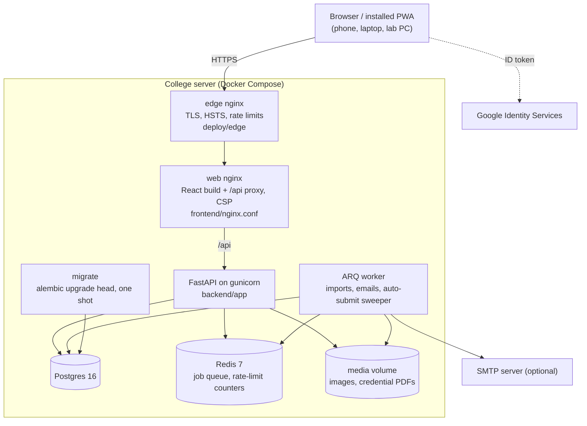
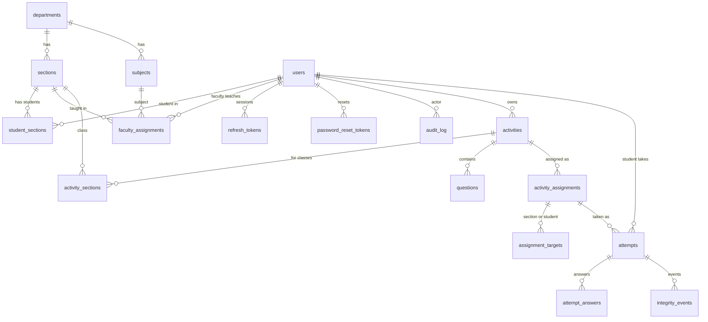
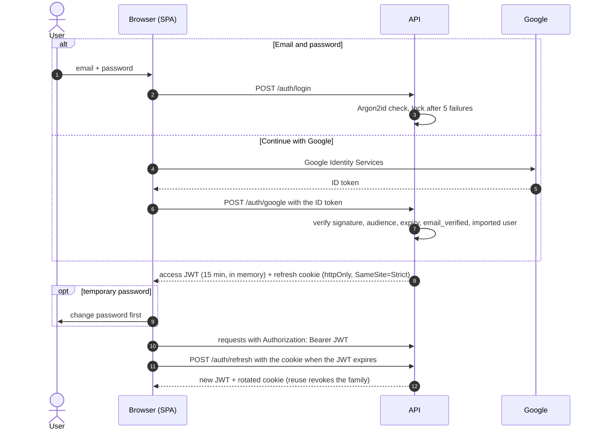
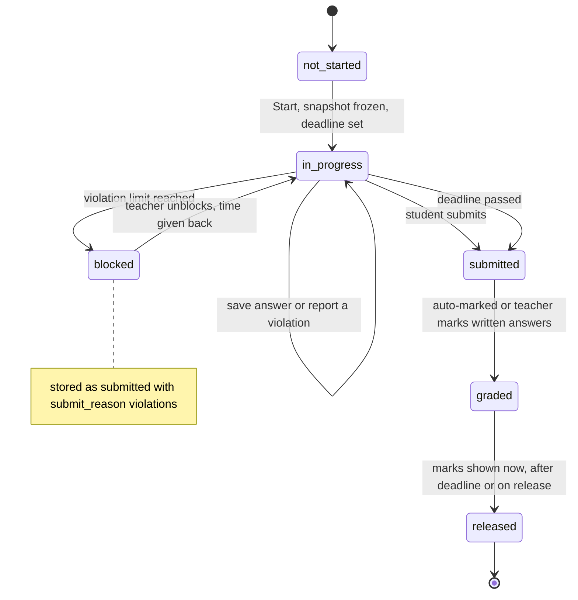
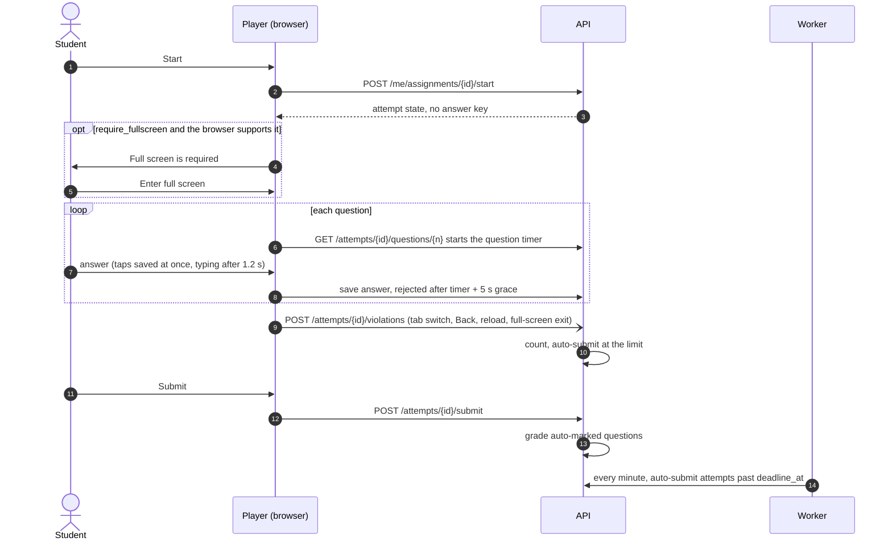
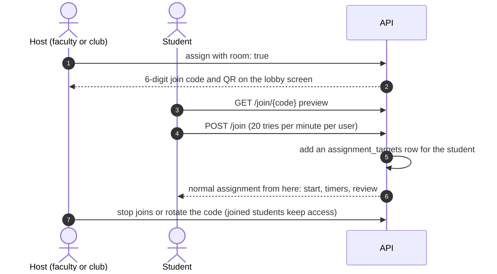
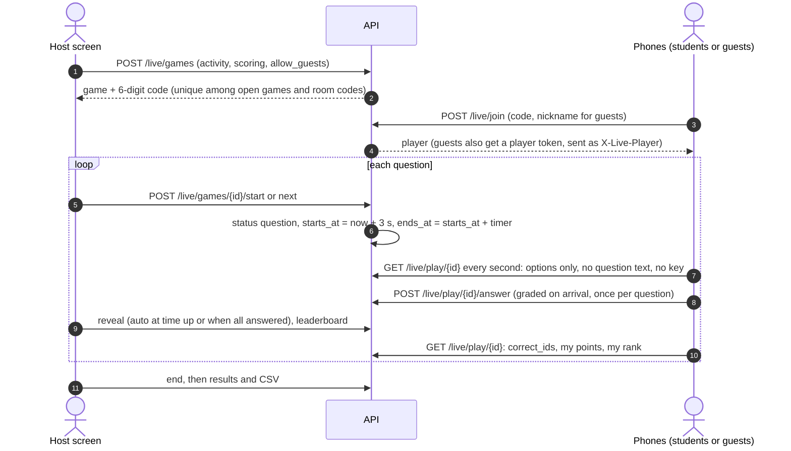
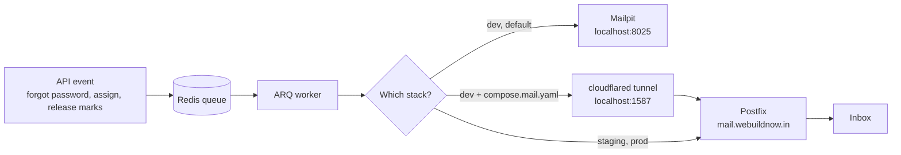
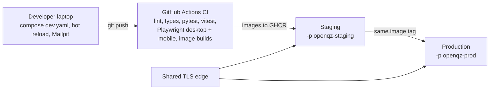

# Architecture

## Components

| Component | Role |
| --- | --- |
| `frontend/` | React 19 + TypeScript SPA, installable PWA. Built into the `web` image, which also proxies `/api`. |
| `backend/app/api/v1` | FastAPI routers: `auth`, `users` (+ `audit`), `org`, `imports`, `activities`, `results`, `play`, `media`, `integrity`, `health`. |
| `backend/app/services` | Business logic: auth, Google token check, import parse / commit, credential PDF, grading, attempts, email, audit. |
| `backend/app/worker` | ARQ worker: import jobs, emails (reset, assigned, released), and a cron job that auto-submits expired attempts every minute. |
| `migrate` | One-shot `alembic upgrade head` before the API starts. |
| Postgres | All data. Redis: job queue and rate-limit counters. |

## Data model

| Table | Key columns |
| --- | --- |
| `users` | email (login id), username (USN or employee ID), role, department, password hash, `google_sub`, lockout fields |
| `import_jobs` | kind, status, header map, preview rows, error rows, credential PDF path |
| `activities` | owner, kind (quiz, assignment, poll, flashcards), status, department, subject, timer |
| `questions` | type, stem, options, answer key, marks, explanation, tags, timer, rubric |
| `activity_assignments` | window, shuffle, feedback, review and marks release rules, notify, violation limit, `require_fullscreen`, `join_code`, `accepting_joins` |
| `attempts` | student, frozen question snapshot, `deadline_at`, linear mode, late, violations, score, `needs_manual`, `unblocked_count` |
| `attempt_answers` | response, timers, locked, `submit_locked`, auto and manual score, rubric scores, feedback |
| `integrity_events` | user, attempt, session, kind, client time, meta |
| `media` | uploaded images |

- `users.email` is the login id: lower-case, unique (functional index on `lower(email)`). `users.username` is the USN or employee ID, unique case-insensitively, shown in lists and reports. `users.google_sub` pins the linked Google account.
- Sections belong to an academic year (`2026-27`); a student has one section per year.
- An activity records the classes it is for (`activity_sections`, any number of sections across semesters and branches). Faculty may pick only sections they teach, in any branch (checked in `activities.resolve_classes`); `/me/classes` returns those classes plus `branches`. `activities.department_id` is the branch of its sections, or null when they mix branches. Admins may pick any sections. Club organisers pick none. The library filters by `department_id`, `semester` and `section_id`. Assigning to sections adds them to `activity_sections` (and recomputes the branch), so an activity's classes always include where it was given; migration 0010 back-filled this for older assignments.
- Marks are `NUMERIC`, never floats.

## Authentication

- **Email + password:** Argon2id. Five failures lock the account for 15 minutes. Rate limits per IP (Redis and nginx) and identical errors and timing for unknown emails.
- **Google:** Google Identity Services gives the browser an ID token; `/auth/google` verifies signature (Google JWKS), audience, issuer, expiry and `email_verified`, then signs in the existing user with that email. First use stores `google_sub`; later logins must match. An unused temporary password is cancelled.
- **Tokens:** 15-minute access JWT in memory; rotating refresh token in an `httpOnly`, `SameSite=Strict` cookie, stored hashed; reuse revokes the family.
- **Forgot password:** single-use 30-minute token emailed by the worker; stored hashed; using it burns all outstanding tokens and revokes sessions.
- **Forced change:** temporary passwords block every route except `/auth/*` with `403 password_change_required`.
- **Roles:** `admin`, `faculty`, `student`, `club`. `CreatorUser` (admin, faculty, club) may build activities and host rooms; `StaffUser` (admin, faculty) may assign to classes and read class lists.
- **RBAC:** `require_roles(...)` per route; ownership checks for faculty and club data; students reach only their own attempts.

## Attempts, timers and integrity

- On start the questions are **frozen into `attempts.snapshot`** (shuffled per student when enabled). The answer key and rubric never leave the server (`grading.strip_key`). Later edits to the activity do not affect existing attempts.
- **Server-side timers:** `deadline_at` = start + activity timer, capped by the deadline unless late work is allowed. A question timer starts when the question is first opened. Saves after a timer (plus 5 s grace) are rejected and the question locks. Any request after `deadline_at` auto-submits; the worker's cron sweeps abandoned attempts every minute.
- **Window:** an assignment is open from `start_at` (counted as open up to 5 s early, `OPEN_EARLY`, so a small server clock step never hides one assigned "now") to `due_at`, or later when late work is allowed.
- **Linear mode:** if any question has a timer, questions are answered in order with no going back.
- **Instant feedback:** an answer confirmed with `final: true` is graded at once and locked.
- **Unblock:** `POST /activity-assignments/attempts/{id}/unblock` reopens an attempt whose `submit_reason` is `violations` (and only if no newer attempt exists). `attempt_answers.submit_locked` marks answers closed only by the submit, so those reopen while timer and instant-feedback locks stay; the deadline and open question timers shift by the blocked time plus `extra_minutes`; violations reset; `attempts.unblocked_count` and the audit log record it.
- **Full screen:** `activity_assignments.require_fullscreen` (default true) makes the player hide the questions behind a gate until `document.fullscreenElement` is set, wherever the Fullscreen API exists (not on iPhone). Exits are reported as `fullscreen_exit` violations.
- **Integrity:** the player reports tab or app switch, focus loss (over 1.5 s), Back, reload and fullscreen exit to `POST /attempts/{id}/violations`. The server counts them and auto-submits at the assignment's limit.

## Rooms (join with a code)

- An assignment created with `room: true` gets a unique 6-digit `join_code` (from `secrets`, retried on collision). It may have no class targets: it is reached only by code.
- `GET /join/{code}` returns a preview (title, host, question count, timer, deadline, open or not). `POST /join` adds the student as an `assignment_targets` row, after which everything (start, timers, violations, review, reports) is the normal assignment path.
- The host can stop new joins (`accepting_joins = false`) or rotate the code (`POST /activity-assignments/{id}/new-code`); students already joined keep access.
- Joining is rate-limited to 20 tries per minute per user, so codes cannot be guessed by brute force (10^6 codes).
- Club organisers can only host rooms; they never see class lists.

## Live games (Kahoot-style)

The host's screen shows the question; players' phones show only the options. Everyone moves together: the host drives the state, phones poll it once a second.

- Tables: `live_games` (status `lobby`, `question`, `reveal`, `leaderboard`, `ended`; `scoring`; `allow_guests`; frozen `snapshot` with the key; `version` bumped on every change), `live_players` (user or guest with a hashed token; nickname unique per game; points, marks, total answer time; `removed`), `live_answers` (one per player and question).
- Only `mcq`, `true_false` and `multi_select` questions are played; polls are always scored "for fun".
- Points: `1000 x fraction correct x (1 - 0.5 x answer time / timer)`. Marks use the normal grader (`grading.grade`), so partial credit for multi-select works the same. "Fun" scoring records no marks.
- Rules on the server: answers only between `starts_at` and `ends_at` + 1 s, once per question; the key reaches phones only after the reveal; guests only when allowed; nicknames filtered (`live_service.clean_nickname`); joins and code lookups rate-limited per user or per IP; the host can remove a player.
- Capacity: polling at 1 s is about one light request per player per second; fine for a class or an event hall. Server-sent events would be the next step for very large audiences.

## Grading and reports

- `services/grading.py` (pure functions): MCQ / True-False exact; multi-select partial credit (right minus wrong, floor 0) or all-or-nothing; fill-in-the-blank per blank with alternatives, case and trailing-dot tolerant; justify and open answers wait for a teacher (empty answers score 0). Polls and flashcards are never scored.
- Manual grading takes one score or, with a rubric, marks per criterion (summed, each capped at its maximum).
- **One attempt per student**: `start` refuses a second attempt (`already_taken`); the Attempts setting was removed from the API. `max_attempts` stays in the table only so the load-test seed can allow unlimited starts. Reports use the submitted attempt. Exports: CSV and Excel (Summary, Students, Marks by question, Questions).
- Reports show **marks obtained** per student (overview grid of student x question cells: correct, partial, wrong, pending, blank), average and highest / lowest marks. Marks visibility: immediately, after the deadline, or when released. Review visibility: after submit, after the deadline, or never.

## Email

Optional (`SMTP_HOST`). Sent only by the worker, never inside a request. Messages: password reset, "new activity assigned", "marks released". Development and CI use Mailpit. Local setup with the real server: [email.md](email.md).

## Performance-relevant choices

- Hot student endpoints load only what they need (`raiseload` / `defer` on attempt listings and answer saves).
- The DB pool per process is configurable; keep total connections below Postgres `max_connections`.
- nginx re-resolves container names every 10 s, so a redeployed API is picked up without 502s.
- The web nginx gzips app files (main bundle about 430 kB to 136 kB) but **not** `/api` responses, which carry tokens (BREACH). Hashed `/assets/` are cached for a year; the service worker keeps them for repeat visits.

## Environments

See [runbook.md](runbook.md). Development uses `compose.dev.yaml` (bind mounts, reload, Mailpit). Staging and production use `compose.prod.yaml` with pinned GHCR images on one server, separated by Compose project name, behind the shared TLS edge.
