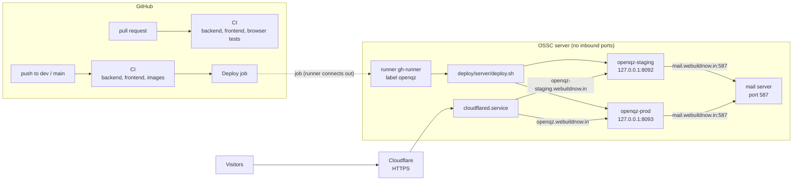
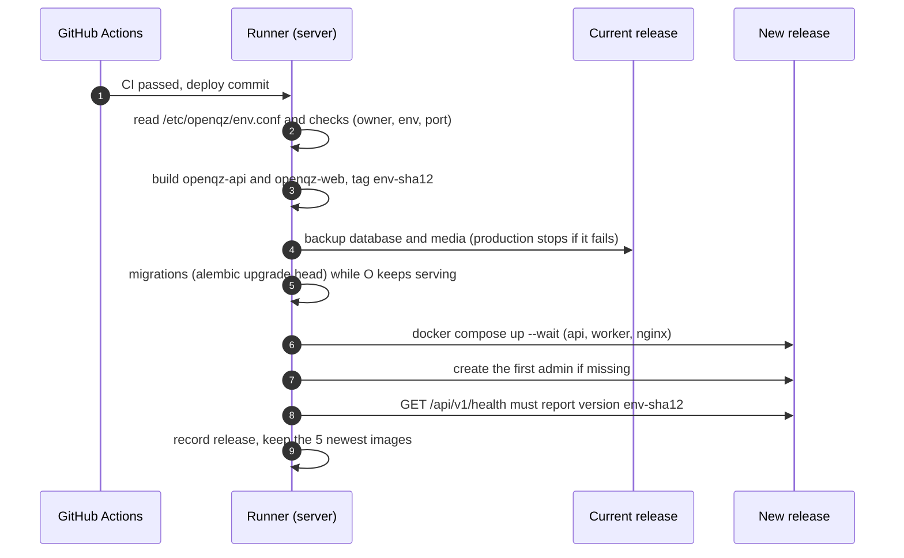

# Deploying to the OSSC server

OpenQZ runs on the OSSC server (Dell Precision 7820, Ubuntu 24.04) next to PCMS and DBIT PageCraft, and deploys the same way: a push to GitHub runs CI, then a **self-hosted GitHub Actions runner on the server** builds and starts the release. Visitors arrive through the server's existing **Cloudflare tunnel**; no port is open to the internet and GitHub holds no server secret. The server's own runbook (ports, folders, rules for every app) is `docs/SERVER.md` in the PCMS repository.



| Branch | Goes to | Hostname | nginx on the server | Compose project |
|---|---|---|---|---|
| pull request | nowhere, CI only | | | |
| `dev` | **staging** | `openqz-staging.webuildnow.in` | `127.0.0.1:8092` | `openqz-staging` |
| `main` | **production** | `openqz.webuildnow.in` | `127.0.0.1:8093` | `openqz-prod` |

## 1. Ports

Only the web nginx is published, on `127.0.0.1` (the tunnel connects there). The API, worker, Postgres and Redis stay on the stack's internal network.

Already used on the server (from the PCMS and PageCraft runbooks, 8 November 2026): 22 SSH, 676/677 and 8082/8083 PCMS, 8080 OSSC website, 8081, 8000/6001/6002 Coolify, 8090/8091 and 3090/3091 PageCraft, 9000/9443 Portainer, 9090 Cockpit, 4317/4318 OpenTelemetry, 20128 OmniRoute, 587 mail. OpenQZ takes **8092** (staging) and **8093** (production).

Before the first setup, confirm on the server and record them:

```sh
sudo ss -ltnp | grep -E ':(8092|8093) '      # must print nothing
```

Then add two rows to the port table in PCMS `docs/SERVER.md`: `8092 | OpenQZ staging nginx | openqz-staging.webuildnow.in` and `8093 | OpenQZ production nginx | openqz.webuildnow.in`. If a port is taken, choose another and change it in `deploy/server/setup-environment.sh`, this file and the Cloudflare hostname.

## 2. One-time server setup

**a. The runner** (one per repository, like PCMS and PageCraft). GitHub: the repository, Settings, Actions, Runners, **New self-hosted runner**, Linux; copy the value after `--token`. On the server, from any checkout of the repository (or after downloading the scripts from `raw.githubusercontent.com/OSSC-DBIT/openqz/main/deploy/server/`):

```sh
sudo bash deploy/server/install-runner.sh <registration-token>
```

It installs the runner in `/srv/actions-runner-openqz` as `gh-runner` (the user PCMS and PageCraft already use) with the label `openqz`, and starts it as a service. The Runners page should show `ossc-server-openqz` as **Idle**.

**b. The environments:**

```sh
sudo bash deploy/server/setup-environment.sh staging    --admin-email <your email>
sudo bash deploy/server/setup-environment.sh production --admin-email <your email>
```

It asks for the password of the mailbox `dbit-oscc` (press Enter to skip and fill it in later). Each run creates, and never overwrites:

| Path | What | Owner, mode |
|---|---|---|
| `/srv/server-data/<env>/openqz/openqz.env` | all settings and secrets: database password, JWT secret, first admin, mail, port, size | root:openqz 640 |
| `/srv/server-data/<env>/openqz/db/` | PostgreSQL data (`DB_HOST_DIR`) | uid 70 (postgres) 700 |
| `/srv/server-data/<env>/openqz/redis/` | Redis data: sessions queue, rate limits (`REDIS_HOST_DIR`) | uid 999 (redis) 700 |
| `/srv/server-data/<env>/openqz/media/` | uploads and import sheets of that environment (`MEDIA_HOST_DIR`; `/data/media` in the containers) | uid 1000 (the app user) 750 |
| `/srv/server-data/<env>/openqz/backups/` | database dumps and media, before every deploy and nightly, kept 30 days | root:openqz 2770 |
| `/etc/openqz/<env>.conf` | project, env file, health URL, local mail on, backup folder. No secrets | root 644 |
| `/etc/cron.d/openqz-<env>` | the nightly backup (production 01:30, staging 02:30) | root 644 |
| `/var/lib/openqz-deploy/` | current and previous release, history, lock | gh-runner |
| `/usr/local/bin/openqz` | helper command (section 4) | root 755 |

It prints the first admin's password once: store it, sign in after the first deploy and change it. It also checks that ports 8092 / 8093 are free and that the mail server on 587 is reachable from containers (section 5).

Everything of one environment is in one folder:

```
/srv/server-data/production/openqz/
  openqz.env     settings and secrets
  db/            PostgreSQL data
  redis/         Redis data
  media/         uploads and import sheets
  backups/       nightly and pre-deploy backups (database dump + media)
```

Copying the folder is not a backup of a running database; use `backups/` (or `sudo openqz <env> backup`).

**c. Cloudflare.** Zero Trust, Networks, Tunnels, the server's existing tunnel, **Public hostname, Add**:

| Subdomain | Domain | Type | URL |
|---|---|---|---|
| `openqz-staging` | `webuildnow.in` | HTTP | `localhost:8092` |
| `openqz` | `webuildnow.in` | HTTP | `localhost:8093` |

Plain HTTP on that hop is fine: TLS ends at Cloudflare, and nginx takes the visitor's address from `CF-Connecting-IP` (sign-in rate limits are per visitor, not per tunnel) and the `https` scheme from `X-Forwarded-Proto`. Recommended in Cloudflare: SSL/TLS mode **Full**, **Always Use HTTPS** on. Do not turn on Rocket Loader or HTML minification (they break the Content-Security-Policy).

Browser tests (`e2e`) run only on pull requests (and by hand: Actions, CI, Run workflow); a push to `dev` / `main` reruns backend and frontend checks, then deploys.

**d. GitHub.**
- Create the `dev` branch from `main` (staging deploys from it).
- Protect `dev` and `main`: pull request and passing CI required, no force pushes. The runner has Docker (root) on the server, so only reviewed code may reach it.
- Settings, Environments, `production`, **Required reviewers** (optional): a push to `main` waits for approval before deploying.
- Settings, Actions: keep "Require approval for all outside collaborators" on. Never approve a run from a fork that changes `.github/`.

**e. Google sign-in (optional).** In the Google Cloud console, add `https://openqz.webuildnow.in` and `https://openqz-staging.webuildnow.in` as Authorised JavaScript origins, then set `GOOGLE_CLIENT_ID` in each env file and redeploy.

Then push to `dev`. GitHub, Actions, **Deploy** shows CI, then the deploy log. When staging works, merge `dev` into `main` for production.

## 3. What a deploy does

`deploy/server/deploy.sh <staging|production> <sha>`, run by the runner from the checked-out commit:



- Files: `compose.yaml` + `compose.prod.yaml` + `compose.mail.yaml` (the mail server is on this machine; `OPENQZ_LOCAL_MAIL=1`).
- One deploy per environment at a time (`flock` on the server, `concurrency` in the workflow).
- A failed deploy prints the logs and stops; the previous containers keep running when the failure is before the switch.

## 4. Day-to-day

```sh
sudo openqz production status          # release, containers, health, last deploys
sudo openqz staging logs api -f        # or worker, nginx, db, migrate
sudo openqz production admin           # create the first admin if missing, show its email
sudo openqz production backup          # back up now
sudo openqz production mailtest        # mail server: connect, TLS, login (sends nothing)
sudo openqz production psql            # open the database
sudo openqz production rollback        # previous release (or: rollback production-<sha12>)
sudo openqz staging compose ps         # any docker compose command for that environment
```

- Deploy: push or merge to `dev` / `main`, never by hand. Redeploy the same commit: Actions, Deploy, **Run workflow**.
- Change a setting or secret: edit the env file, then rerun the Deploy workflow (or `sudo openqz <env> compose up -d api worker`).
- Restore a backup: `deploy/backup/restore.sh` (see [runbook.md](runbook.md), Backups). Rolling back code does not roll back the database; if the release you leave migrated it, restore the backup taken before that deploy.

## 5. Email on the server

The mail server for `mail.webuildnow.in` runs on this machine on port 587. `compose.mail.yaml` points that name at the host, so containers connect to the host's 587 and TLS still checks the real certificate (details: [email.md](email.md), section 3). The setup script fills in `SMTP_HOST=mail.webuildnow.in`, `SMTP_PORT=587`, `SMTP_USER=dbit-oscc`, `SMTP_FROM=OpenQZ <dbit-oscc@webuildnow.in>` and asks for the password.

Two host conditions (the setup script checks both):
- 587 must listen on all interfaces, not only `127.0.0.1` (`sudo ss -ltnp | grep :587`).
- With `ufw` on and 587 closed: `sudo ufw allow from 172.16.0.0/12 to any port 587 proto tcp`.

Test with `sudo openqz production mailtest` (`235` means the login works), then request a password reset for your own account.

## 6. Troubleshooting

| Problem | Cause and fix |
|---|---|
| Deploy job: "Waiting for a runner" | The runner is offline. `systemctl status 'actions.runner.*'`; `cd /srv/actions-runner-openqz && sudo ./svc.sh start`. |
| "env file ... is not readable" | The runner is not in group `openqz`, or was not restarted after being added: `sudo usermod -aG openqz gh-runner && sudo systemctl restart 'actions.runner.*'`. |
| "host port 8093 is held by Compose project ..." | Another stack took the port. `sudo ss -ltnp \| grep 8093`; move one of them (env file + `/etc/openqz/<env>.conf` + Cloudflare). |
| "MEDIA_HOST_DIR ... must be owned by uid 1000" | `sudo chown -R 1000:1000 /srv/server-data/<env>/openqz/media` (the app user in the container is uid 1000). |
| "backup failed; production is not deployed" | `ls -ld /srv/server-data/production/openqz/backups` must be `root:openqz` with mode `2770`; rerun the setup script. |
| "did not report version" | The new API did not answer through nginx. `sudo openqz <env> logs api`. Often a changed `POSTGRES_PASSWORD` (the volume keeps the old one) or `ALLOWED_HOSTS` without `127.0.0.1`. |
| Everyone gets 429 on sign-in | nginx does not see visitor addresses: traffic must come through the tunnel (`CF-Connecting-IP`). |
| Sign-in works but the session is lost on reload | `COOKIE_SECURE=true` needs HTTPS: open the site through `https://openqz.webuildnow.in`, not `http://<server-ip>:8093`. |
| Emails: `Timed out` / `Connection refused` | Section 5: 587 listens on localhost only, or the firewall blocks the Docker networks. |
| Emails: `535 authentication failed` | Wrong `SMTP_PASSWORD` in the env file. Fix it, rerun the Deploy workflow. |
