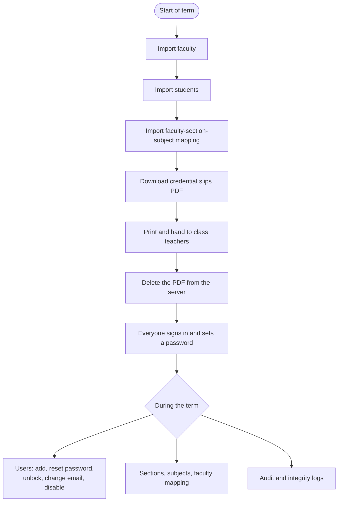

# OpenQZ admin guide

The admin sets up departments, classes and accounts, imports the office sheets, and looks after sign-in problems. Server tasks (deploy, TLS, backups) are in the [runbook](https://github.com/ossc-dbit/openqz/blob/main/docs/runbook.md).

## At a glance

## 1. First sign-in

Use the admin email and temporary password from the server setup, then choose your own password. Every page is in the left menu. Use the eye button next to a password field to show or hide what you typed; the field starts hidden.

## 2. Bring everyone in (start of term)

Import in this order from **Imports**:

1. **Faculty**: Employee ID, Full Name, Email, Department.
2. **Students**: USN, Full Name, Email, Department, Semester, Section.
3. **Faculty-section-subject mapping**: Employee ID, Department, Semester, Section, Subject Code, Subject Name.

Download the templates on the Imports page. Column names are matched loosely ("Roll No" works for USN, "Emp ID" for Employee ID). **Everyone needs a unique email**: it is how they sign in.

For each upload:

1. Pick the type and the **academic year**, choose the `.csv` or `.xlsx` file, press **Upload and preview**.
2. Check the **Column mapping** and fix any column OpenQZ could not match, then **Re-check**.
3. Rows with problems are listed with the reason (missing field, invalid email, duplicate USN or email, email already used by someone else, faculty not found). They will be skipped. Fix them in the sheet and import again later if needed.
4. Press **Import N valid rows**.
5. Download **Credential slips (PDF)**: one slip per new account with the email and temporary password, grouped by section. Print them, give them to class teachers, then press **Delete PDF from server**.

Re-importing the same sheet is safe: existing people are updated, nobody is duplicated, and no new passwords are made for existing accounts. A student who moved section is moved.

## 3. Day-to-day tasks

| Task | Where |
| --- | --- |
| Add one person | **Users**, then **Add user** (gives a temporary password to hand over). Fill in the ID, role, name and email; optionally phone and designation. For a **student** choose the department and **section** (needed to receive class assignments). For **faculty** tap every **department** they work in: the first one is the main department. |
| Edit a person | **Users**, pencil icon: name, email, phone, designation, departments, section. |
| Reset a password | **Users**, key icon. Gives a new temporary password; they must change it at next sign-in. |
| Unlock an account | **Users**, lock icon (accounts lock for 15 minutes after 5 wrong passwords). |
| Change someone's sign-in email | **Users**, pencil icon. Their old Google link is removed. |
| Find people | Search by name, email, phone or ID; filter by role and by department (faculty appear under every department they belong to). |
| Delete a person for good | **Users**, bin icon. OpenQZ first shows what goes with them (their attempts; for a teacher, the activities they made and all student work on those). Type their ID and **your own password** to confirm. This cannot be undone: to keep the work, **Disable** instead. You cannot delete yourself or the last admin. |
| Disable / enable an account | **Users**, **Disable**. Disabled people cannot sign in; their work is kept. |
| Departments and sections | **Sections**. Sections belong to an academic year (for example 2026-27). |
| Subjects | **Subjects**. |
| Delete a section | **Sections**, bin icon. Students keep their accounts and only leave the section; its teacher mappings go. Refused while work assigned to the section has student attempts: delete those results first. |
| Delete a subject | **Subjects**, bin icon. Teacher mappings through this subject go; activities keep their questions and results. |
| Delete a department | **Sections**, bin icon next to the department. Only an empty department can go: delete its sections and move its people first. |

Every delete asks twice: first it shows what will go, then **Are you sure?**. Press **No, keep it** to back out.
| Who teaches what | **Faculty mapping**. Faculty only see and assign to sections mapped here. Map a teacher to sections of several branches (for example first-year maths for CSE and ECE) and they can pick any of them. |
| Club accounts | **Users**, then **Add user**, role **Club organiser**. Use the club's shared email (for example `techclub@...`). |

On a phone the lists stay narrow: a person's role and status show under their name, and department and last sign-in appear on wider screens.

### Club organisers

A club organiser (tech club, cultural committee, placement cell) can build activities and **host rooms** with a join code, which any signed-in student can join. They cannot assign to classes, see class lists, import people or open other people's activities and reports. Club organisers can also run **live games** (Kahoot-style: question on the projector, answers on phones) and may let guests join with a nickname, for events with visitors. Disable the account when the club's term ends; its results are kept.

## 4. Sign-in options

- **Email and password** always works.
- **Continue with Google** appears when the server has a Google client id. It only signs in people whose email you imported. See the runbook section *Google sign-in*.
- **Forgot your password?** appears when the server has email (SMTP) set up. Otherwise people ask you to reset it.

## 5. Watching over things

- **Integrity log**: tab switches, Back presses, reloads during quizzes.
- **Audit log**: sign-ins, failed sign-ins, lockouts, password resets, imports, credential downloads, score releases. Filter by action or search by person.
- **Statistics**: how OpenQZ is used across the college. Tiles for the totals, a table **by department** (students, faculty, sections, class assignments, students assigned, submitted, completion and average marks) and a table **by teacher and organiser** (activities made, class assignments, rooms, live games, completion, average marks, answers waiting for grading). Choose a day range (by the day an activity was assigned) and a department. **Excel** downloads everything in one file (Summary, Departments, Faculty); the two **CSV** buttons download one table each.
- **Dashboard**: counts of students, faculty, sections and teaching assignments for the current academic year.

Admins can also open the faculty **Library** and **Reports** to see everything:

- **Questions and answer keys**: **Library**, open any activity. The editor shows every question with its correct answer, marks and timer; **Preview** shows it as a student sees it. To change the correct answer, press **Edit** on a question and press **Correct** on the right option. A report's **Questions** tab also marks the correct answer of every question.
- **What each student answered**: **Reports**, open an assignment, then a student's row: every answer, the marks given and any warnings.
- **Delete an activity for good**: in the activity editor, **Delete for good (admin)** removes the activity with every assignment and all student attempts. (A teacher's own Delete only archives an activity that students have attempted.)
- **Delete the results of one assignment**: in its report, **Delete results**. The activity and its questions stay.

Both deletes ask you to type the activity's title and your own password. After 5 wrong passwords deleting is locked for 10 minutes, and every delete is recorded in the **Audit log**.

## 6. Privacy

- Credential slips contain passwords: print, hand out, then delete the PDF from the server.
- Passwords are stored as one-way hashes; nobody, including the admin, can see them.
- Export only what you need, and keep downloaded files on college devices.
