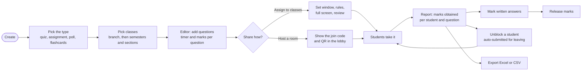
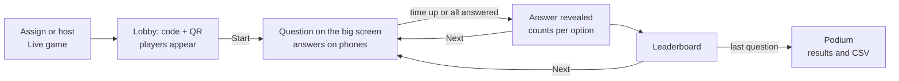

# OpenQZ faculty guide

Create quizzes, assignments, polls and flashcards for your classes, assign them, and see results and marks in one place.

## At a glance

## 1. Sign in

Sign in with your **email** and the temporary password from your slip, or with **Continue with Google** if your Google account uses the same email. Choose your own password on first sign-in. Use the eye button next to a password field to show or hide what you typed; the field starts hidden.

Your **Home** page has:

- one-tap **create** tiles (Quiz, Assignment, Poll, Flashcards) that open straight at the title step;
- your numbers: classes you teach, activities assigned, how many are open now, and submissions so far;
- **Recently assigned**, each with its classes, deadline (or join code for a room) and a submitted bar; tap one to open its report;
- **My classes**: the sections and subjects the admin has mapped to you. If a class is missing, ask the OpenQZ admin to add the mapping.

## 2. Create an activity

Press **Create** (top of the menu on any page), or **Library**, then **Create**:

| Type | Use it for |
| --- | --- |
| **Quiz** | Auto-marked questions, usually with timers. |
| **Assignment** | Longer work with written answers you mark yourself. |
| **Poll** | Opinions; no right answer, results show how many chose each option. |
| **Flashcards** | Self-study cards with a front and a back. |

Then give it a **title** and choose **which classes** it is for:

- **Branch** first (for example CSE or ECE). Only branches where you teach a section are shown; the number on a branch is how many of its sections you picked.
- Then the sections you teach in that branch, grouped by semester. Tap as many as you like, across **several semesters**. Tap **Sem N** to select (or clear) every section of that semester. Switch branch to add sections from another branch to the same activity.
- The line under the picker lists everything selected.
- **Create** stays disabled until you pick at least one class.

You can change the classes later with **Edit classes** in the editor header. In the **Library**, the sections on the left (All activities, Published, Drafts, Previously used, Archived), the search box, the type, semester and section filters and the sort help you find things. Each row has **Edit**, **Assign** and **Duplicate**.

**Club organisers** do not pick classes: their activities are shared only through a room code (see section 5).

## 3. The editor

The editor fills the whole screen. The top bar has the title (click to rename), Draft / Published, **Preview** and **Assign or host**. The panel on the left shows the question count, total marks and classes (**Edit classes**), **Duplicate** and **Delete**, and **Timer / marks for all** (pick a timer and/or marks, then **Update all questions**).

Every question is a card showing its type and answers. Change its **timer** and **marks** right on the card. **Drag** a card by its handle to reorder (or use the arrows), and use **Edit**, **Duplicate** or **Delete** on each card.

**Add question** opens the list of question types; pick one and the full-screen question editor opens. Press **Save question** to add it, or **Cancel** to discard.

For each question:

| Setting | What it does |
| --- | --- |
| **Type** | Multiple choice, True / False, Multi-select, Fill in the blanks, Justify your answer, Open ended. |
| **Timer** | No timer, or 5 seconds to 10 minutes. Type any number of seconds (5 to 3600) in **Custom s**. |
| **Marks** | How many marks the question is worth. |
| **Image** | Add an image to the question and to any answer tile (PNG, JPEG, GIF or WebP, up to 5 MB). |
| **Answer explanation** | Shown to students after they answer (if you allow it). |
| **Tags** | Your own labels, for example `unit2, recursion`. |

Question types in detail:

- **Multiple choice / Justify:** mark exactly **one** tile correct. For Justify, students also explain their choice and you mark the explanation.
- **Multi-select:** mark **every** correct tile. With **Partial credit** on, students get marks for each right tile minus each wrong tile (never below zero).
- **True / False:** tap the right answer.
- **Fill in the blanks:** write `___` in the question for each blank, then list the accepted answers per blank, separated by `|` (for example `colour | color`). Case and extra spaces are ignored unless you tick **Case sensitive**.
- **Open ended:** students type an answer; you mark it from the report.

**Rubric (open ended and justify):** split the marks into criteria, for example *Correct concept 3* and *Clear writing 2*. The criteria must add up to the question's marks (use **use N as marks** to fix that in one click). You then mark each criterion separately.

**Timer / marks for all** sets the same timer and/or marks on every question at once. **Preview** shows the questions exactly as students see them (tick **Show answers** to check your keys). **Duplicate** copies the activity.

## 4. Assign or host

Press **Assign or host** in the editor and choose how students get it:

- **Assign to classes**: students of the selected sections see it on their home page. The activity's classes are already selected; add or remove sections as needed. Sections you assign to are added to the activity's classes, so the editor and the library filters show them.
- **Host a room**: OpenQZ makes a 6-digit **join code**. Any signed-in student can join with it, from any class or department (good for extra sessions, guest lectures and events). See section 5.

| Setting | Meaning |
| --- | --- |
| **Who** | (Assign only) One or more of your sections, across semesters. |
| **Start / Deadline** | When it opens and closes. Blank start means now. With a later start students see it at once as **not started**, with the opening time, and it opens by itself. If you change the deadline later, students who are already in the middle follow the new deadline. |
| **Instructions** | Optional note for the students: what to keep ready, rules, how marks are given. They read it before they start; it is also in the email and in a room's join preview. |
| **Allow late submissions** | Students can still start after the deadline; their work is marked *late*. |
| **Activity timer** | Minutes for the whole activity (overrides the activity's own timer). |
| **Shuffle questions / answer options** | Every student gets their own order. |
| **Show answer after each question** | Students see right/wrong and the explanation immediately; that answer then locks. |
| **Students can review answers** | After they finish, after the deadline, or never. |
| **Show marks** | Right after submitting, after the deadline, or only when you press **Release marks**. |
| **Email students** | Sends an email when assigned (with the opening time and your instructions), when a scheduled start time comes, and when you release marks (if your college has email set up). |
| **Require full screen** | On by default. Students see the questions only in full screen; leaving full screen counts as a warning. iPhone browsers have no full screen, so it is skipped there. |
| **Tab switches / Back / reload allowed** | Warnings before the attempt is submitted automatically. **0** only records them. |

Every student gets **one attempt** (no retakes). If an attempt was submitted automatically by mistake, use **Unblock** (see below).

Questions **lock as soon as the first student starts**: you can no longer add, edit or delete them, so every student gets the same paper and the report stays consistent. To change the questions, use **Duplicate** in the library and assign the copy.

## 5. Rooms (join with a code)

After **Host room**, the report page opens with a large banner:

- the **code** (for example `827 576`) and the address students open (`/join`),
- a **QR code** students can scan, and **Copy link** to paste in a class group,
- **Stop new joins** / **Allow joins**: close the room to newcomers; students who already joined keep going,
- **New code**: the old code stops working (use it if the code leaked); students who joined keep access,
- a live count: *joined*, *finished*, and whether the room is open,
- **Present**: a full-screen lobby for the projector with the address, the big code, the QR code and the names of players as they join (Esc or **Close** to leave).

The participant list updates every few seconds while you have the page open. All the other settings (deadline, attempts, timers, warnings, scores) work exactly as for a class assignment.

## 5b. Live games (Kahoot-style)

A live game is played together, at the pace you set. **Your screen (the projector) shows the question; students' phones show only the coloured answers.** Good for revision in class, labs, tech fests and club events.

1. Open a quiz or poll, press **Assign or host**, choose **Live game**.
2. Pick the **Scoring**:
   - **Marks + speed bonus**: marks as usual; on the leaderboard, faster correct answers earn more points (up to 1000 per question, half at the last second).
   - **Marks only**: ranked by marks, ties by total answer time.
   - **Just for fun**: points only, nothing counted as marks. Polls are always "just for fun".
3. **Let guests join with a nickname**: tick it for open events (no account needed). Leave it off for class games, so only signed-in students with real names can play. Nicknames are checked for rude words and must be unique in the game.
4. Press **Start live game**. The lobby shows `.../live`, the 6-digit code and a QR code. Players appear as they join; click a name to remove someone. **Stop new joins** closes the door.
5. Press **Start**. Each question gets a 3-second "get ready", then its timer (the question's own timer, or 20 seconds). The answer is shown automatically when time is up or everyone has answered; **Show answer** ends it early.
6. After each question: **Leaderboard** (top 5) or straight to **Next**. After the last one, **Finish** shows the podium.
7. **View results** (also under **Reports, Live games**): every player's rank, points, **marks obtained**, correct answers, per-question stats and a CSV export.

Live games use the **multiple choice, true / false and multi-select** questions of the activity; other types are skipped. Integrity checks (full screen, tab switches) do not apply: the game is paced on the big screen.

## 6. Reports and marking

**Reports** (called **Rooms & reports** for clubs) lists everything you assigned or hosted. Open one to see:

- **Tiles:** completion, average marks (with average accuracy), highest / lowest marks, how many still need marking.
- **Overview:** each student's **marks obtained** (out of the total, with accuracy), then a grid of every student against every question: green correct, amber partly correct, red incorrect, blue to grade, grey not answered. Click a name to open the attempt.
- **Participants:** each student's status, **marks obtained**, accuracy and flags (*to grade*, *late*, *N violations*, *auto-submitted*). **View** opens the full attempt.
- **Questions:** accuracy per question, average marks and, for options, how many students chose each one. Low accuracy questions show what to re-teach.
- **Grading:** every written answer waiting for marks. Enter marks (per criterion if there is a rubric) and optional feedback, then **Save**.

Buttons at the top:

- **Excel**: a workbook with *Summary*, *Students*, *Marks by question* (a marks register: every student x every question) and *Questions* sheets.
- **CSV**: one row per student, for any other tool.
- **Edit deadline**: extend it or allow late work.
- **Release marks**: when marks are set to "when I release them".

### Unblocking a student

When a student reaches the warning limit, their attempt is submitted automatically and the report shows a red **blocked** badge with an **Unblock** button (also inside **View**). If it was a mistake (a notification, a dropped connection, a student you have spoken to), press **Unblock**:

- their answers so far are kept and the questions they had not finished open again; answers locked by a question timer or by *show answer after each question* stay locked,
- warnings start again from 0 (every warning stays in the integrity log),
- if the activity has a timer or deadline, the time they spent blocked is given back; add **Extra minutes** if you want to give more.

A student still on the results screen gets a **Continue the quiz** button within a few seconds; otherwise they press **Resume** on their home page. You cannot unblock an attempt the student submitted themselves, or one after which they already started a new attempt. Every unblock is recorded in the audit log and the report shows *unblocked Nx*.

## 7. Integrity log

**Integrity log** lists every tab switch, Back press, reload or full-screen exit recorded during attempts at **your** activities, with the student and time. Use it with the *violations* column in the report.

## 8. Good practice

- Use **Preview** before assigning.
- For a timed test, set a short question timer and keep **Shuffle** on.
- Release marks only after marking written answers when you use **When I release them**.
- Download the **Excel** file at the end of the term for your records.
- For a room, put the QR code on the projector and press **Stop new joins** once everyone is in.
