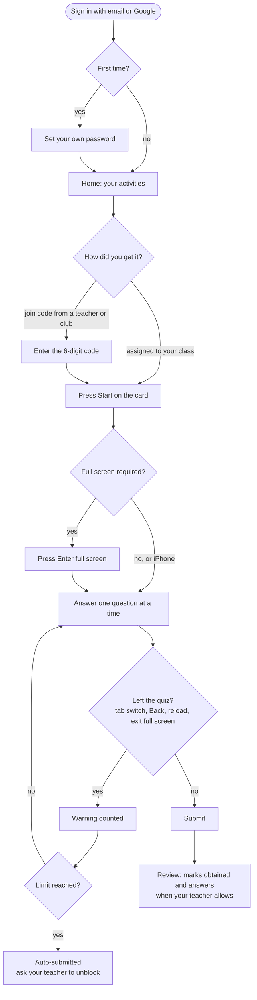

# OpenQZ student guide

OpenQZ is where your faculty post quizzes, assignments, polls and flashcards. It works in any modern browser on your phone or laptop.

## At a glance

## 1. Sign in

1. Open the OpenQZ address your college gave you (for example `https://openqz.dbit.co.in`). Visitors see the landing page; choose **Login** in the top navigation to reach the sign-in screen.
2. Sign in with your **email** and the **temporary password** from the slip your class teacher gave you. Or tap **Continue with Google** if your Google account uses the same email.
3. The first time you use the temporary password, OpenQZ asks you to **choose your own password**: at least 8 characters, with upper and lower case letters and a digit.
4. Use the eye button next to a password field to show or hide what you typed; the field starts hidden.

> Signed in with Google before using the slip? The temporary password is cancelled for your safety. Keep using Google, or ask your teacher to reset your password if you want one.

**Forgot your password?** Tap **Forgot your password?** on the sign-in page (if your college has turned on email). You get a link that works once, for 30 minutes. Otherwise ask your class teacher or the OpenQZ admin to reset it.

After 5 wrong passwords your account locks for 15 minutes.

**Have a join code?** The sign-in page has a **Have a join code?** box: type the 6-digit code from the host's screen, or tap **Scan QR code** and point the camera at it. A live game opens at once (as a guest you only pick a nickname, when the host allows guests). For a room, sign in first and you go straight to it.

## 2. Install it like an app (optional)

- **Android (Chrome):** menu, then **Install app** or **Add to Home screen**.
- **iPhone (Safari):** Share, then **Add to Home Screen**.

## 3. Your activities

The home page has two tabs:

| Tab | Shows |
| --- | --- |
| **Pending** | Work you still have to do, with its deadline and time limit. |
| **Completed** | Work you have submitted, with your marks once your teacher shows them. |

Buttons on each card:

- **Start**: begin the activity. If your teacher wrote **instructions**, you read them first and then press **Start now**.
- **Not started yet**: the activity is assigned but opens later. The card shows the opening time and the Start button appears by itself when it opens (you also get an email, if your college has email set up).
- **Instructions**: read your teacher's note again before you start.
- **Resume**: continue an attempt you left. Your answers were saved.
- **Review**: see your answers and marks after submitting.

A **late** badge means the deadline has passed but your teacher still accepts late work.

### Join with a code

Teachers and clubs (for example a tech fest quiz) can host a **room** and share a **6-digit code**, a link or a QR code. Anyone signed in to OpenQZ can join, even if it is not your class.

1. On the home page, type the code in **Got a join code?** and press **Join**. Or press **Join** at the top, or open the link / scan the QR code.
2. Check the title and the host on the card, then press **Join and start**.
3. The activity now also appears under **Pending** and **Completed** like any other.

"No activity with that code" means a digit is wrong or the host made a new code. "Not accepting players" means the host has stopped new joins; ask them to allow joins again.

## 4. Taking a quiz

- You see **one question at a time**, with coloured answer tiles.
- **Tap a tile** to answer. On a keyboard, press **1 to 8** to pick a tile and **Enter** for the next question.
- **Multi-select:** tap every correct tile, then **Submit answer** (or **Next**).
- **Fill in the blanks:** type in each box. Small spelling differences in case and spacing are fine.
- **Justify your answer:** pick a tile, then explain why in the box.
- **Open ended:** type your answer. Your teacher marks it later.

**Timers**

- A **countdown** at the top shows the time left for the whole quiz (shown when under 3 hours).
- A **green bar** under it is the time left for this question. When it runs out, the question locks and the quiz moves on.
- Questions with a timer **cannot be revisited**. Answer in order.
- When the quiz time runs out, your answers are **submitted automatically**.

**Answers save automatically.** If your phone dies or the network drops, sign in again and press **Resume**.

**Right or wrong straight away:** if your teacher turned this on, you see whether you were right (and an explanation) as soon as you answer, and that answer can no longer change.

When you are done, press **Finish** (or **Submit** at the top), then **Submit** again to confirm. You cannot change answers after that.

## 5. Quiz rules (please read)

Most quizzes need **full screen**. Press **Enter full screen** when asked; the questions appear once you are in full screen. (On iPhone this step is skipped.)

While a quiz is open, OpenQZ notices if you:

- switch to another tab or app, or lock your screen,
- press **Back**,
- reload or close the page,
- leave full screen.

Each time, you get a **warning** (for example "Warning 1 of 3"). After the number of warnings your teacher allows, **your quiz is submitted automatically** with the answers you have so far. Your teacher sees every warning.

Notifications that pop up briefly are ignored. Opening another app is not.

If your quiz was submitted because of warnings and it was a mistake, tell your teacher. They can **unblock** you: keep the results page open and a **Continue the quiz** button appears, or press **Resume** on your home page. Your answers are kept and your warnings start again from 0.

## 5b. Live games

In a live game the **question is on the big screen** and your phone shows only the coloured answers.

1. Open `.../live` (or type the code in **Enter a join code** on your home page, or scan the QR code).
2. Enter the 6-digit code. If you are signed in you join with your name; at open events you can join as a guest with a nickname.
3. Wait for **You're in!**. When the host starts, you get a 3-second "get ready", then tap your answer before the timer runs out. For "pick all that apply" questions, tap the answers and press **Submit**.
4. After each question your phone turns green (**Correct!** with your points) or red. Faster correct answers earn more points.
5. At the end you see your place and the top three.

## 6. Results and review

Open **Completed**, then **Review**:

- your **marks obtained** and **accuracy** (if your teacher has released marks),
- each question with your answer, the correct answer and the explanation (if your teacher allows it),
- marks per criterion and your teacher's feedback for written answers.

"Being graded" means your teacher has not marked a written answer yet.

## 7. Flashcards

Tap the card to flip it. Use **Next** and **Previous**, and **Done** at the end.

## 8. Help

- Problems signing in: your class teacher or the OpenQZ admin.
- Something looks broken: tell your teacher what you did and what you saw (a screenshot helps).
