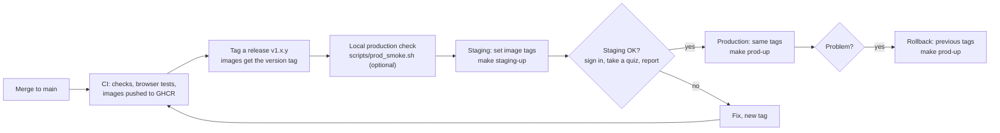

# OpenQZ runbook

Target host: the CSE Dell Xeon workstation (Ubuntu 24.04 LTS, Docker). Staging and production run on the same machine as separate Compose projects, each with its own volumes, env file and sub-domain.

| Environment | Project | Sub-domain | Local port |
| --- | --- | --- | --- |
| production | `openqz-prod` | openqz.dbit.co.in | 127.0.0.1:8081 |
| staging | `openqz-staging` | staging.openqz.dbit.co.in | 127.0.0.1:8082 |

## 1. Server setup (once)

```bash
sudo apt update && sudo apt -y upgrade
curl -fsSL https://get.docker.com | sudo sh
sudo usermod -aG docker $USER      # log out and back in
sudo ufw allow OpenSSH && sudo ufw allow 80 && sudo ufw allow 443 && sudo ufw enable

# storage layout on the 10 TB pool
sudo mkdir -p /srv/openqz /backup/openqz
sudo git clone https://github.com/ossc-dbit/openqz.git /srv/openqz
```

Move Docker's data root to the large disk if `/` is small (`/etc/docker/daemon.json`: `{"data-root": "/data/docker"}`).

## 2. Environment files

```bash
cd /srv/openqz
cp .env.example .env.prod && cp .env.example .env.staging
```

Edit each file:

| Key | Production value |
| --- | --- |
| `ENVIRONMENT` | `production` (or `staging`) |
| `DEBUG` | `false` |
| `ENV_FILE` | `.env.prod` / `.env.staging` |
| `HTTP_PORT` | `8081` / `8082` |
| `PUBLIC_URL` | `https://openqz.dbit.co.in` |
| `JWT_SECRET` | `python3 -c "import secrets; print(secrets.token_urlsafe(64))"` (different per env) |
| `COOKIE_SECURE` | `true` |
| `CORS_ORIGINS` | `https://openqz.dbit.co.in` |
| `ALLOWED_HOSTS` | `openqz.dbit.co.in,api,nginx` |
| `POSTGRES_PASSWORD` / `DATABASE_URL` | long random password, same in both keys |
| `ADMIN_EMAIL` / `ADMIN_PASSWORD` | the first admin's login email and a strong temporary password |
| `GOOGLE_CLIENT_ID` | OAuth client id (see Google sign-in below); blank hides the button |
| `GOOGLE_ALLOWED_DOMAINS` | optional, e.g. `dbit.in`; blank allows any Google account that matches an imported email |
| `API_IMAGE` / `WEB_IMAGE` | `ghcr.io/ossc-dbit/openqz-api:v1.0.0` (pin a tag) |
| `SMTP_*` | the college mail relay (see *Email* below); blank `SMTP_HOST` = no emails |
| `WEB_CONCURRENCY` / `API_CPUS` | gunicorn workers and CPU cap for the API, e.g. `16` / `16` (see [performance.md](performance.md)) |
| `LOGIN_RATE_PER_MINUTE` | sign-in attempts per client address per minute (default 60; a classroom often shares one Wi-Fi address) |
| `DB_POOL_SIZE` / `DB_MAX_OVERFLOW` | connections per process, default `5` / `5`; keep (workers + 1) x (pool + overflow) below 200 |

`chmod 600 .env.*`. Never commit them.

## 3. Start an environment

```bash
make prod-pull && make prod-up               # or the raw compose commands in the Makefile
docker compose -p openqz-prod exec api python -m app.cli create-admin --from-env
curl -fsS http://127.0.0.1:8081/api/v1/health
```

Staging is the same with `make staging-up` and project `openqz-staging`.

## 4. TLS

1. Ask the IT cell for DNS A records: `openqz.dbit.co.in` and `staging.openqz.dbit.co.in` pointing to the server's fixed campus IP. Ports 80 and 443 must be reachable.
2. Get the first certificate (nginx not running yet):

```bash
docker run --rm -p 80:80 -v openqz-edge_letsencrypt:/etc/letsencrypt certbot/certbot:v3.0.1 \
  certonly --standalone -d openqz.dbit.co.in -d staging.openqz.dbit.co.in \
  --agree-tos -m ossc@dbit.co.in --non-interactive
```

3. Start the edge: `docker compose -f deploy/edge/compose.yaml up -d`. Certbot renews automatically. Reload nginx weekly (cron): `docker compose -f /srv/openqz/deploy/edge/compose.yaml exec proxy nginx -s reload`.
4. Check headers with an online scanner (securityheaders.com, ssllabs.com).

## Google sign-in

1. Open https://console.cloud.google.com, create a project (e.g. "OpenQZ"), then **APIs & Services -> OAuth consent screen**: type *External*, app name *OpenQZ*, support email, and publish it (only basic `email`/`profile` scopes are used, so no Google review is needed).
2. **Credentials -> Create credentials -> OAuth client ID**, type **Web application**.
3. **Authorised JavaScript origins:** add every address people open OpenQZ on, exactly, with no trailing slash:
   - `https://openqz.dbit.co.in`
   - `https://staging.openqz.dbit.co.in`
   - `http://localhost` and `http://localhost:8088` for development
   No redirect URI and **no client secret** are needed (the button uses a popup and an ID token).
4. Put the client id in `GOOGLE_CLIENT_ID` of each env file and restart: `make prod-up`.
5. Test: open the login page; "Continue with Google" appears. A Google account whose email is not imported gets "No OpenQZ account uses ...".

If the button shows "origin not allowed", the exact URL in the browser bar is missing from step 3.

## Email (password reset and notifications)

Email is optional. Without it, "Forgot your password?" is hidden and people ask the admin.

1. Get SMTP details from the IT cell (host, port, user, password, sender address). Google Workspace: use `smtp-relay.gmail.com:587`, or an app password on a dedicated account.
2. Set `SMTP_HOST`, `SMTP_PORT`, `SMTP_USER`, `SMTP_PASSWORD`, `SMTP_FROM` (for example `OpenQZ <no-reply@dbit.co.in>`), `SMTP_STARTTLS=true` (port 587) or `SMTP_SSL=true` (port 465) in the env file, and `make prod-up`.
3. Test: on the login page, **Forgot your password?** now shows. Request a reset for your own account and check the mail arrives (and its link uses `PUBLIC_URL`).
4. Emails are sent by the worker: `docker compose -p openqz-prod logs worker` shows failures.

Messages sent: password reset (single-use link, 30 minutes), new activity assigned, marks released. Teachers can untick "Email students" per assignment.

Development: `compose.dev.yaml` points email at Mailpit, a fake inbox at http://localhost:8025. To send real mail from a laptop through the Cloudflare tunnel, and for the sender-domain (SPF) rule, see [email.md](email.md).

## 5. Deploy a new version




```bash
cd /srv/openqz && git pull
sed -i 's/^API_IMAGE=.*/API_IMAGE=ghcr.io\/ossc-dbit\/openqz-api:v1.0.1/; s/^WEB_IMAGE=.*/WEB_IMAGE=ghcr.io\/ossc-dbit\/openqz-web:v1.0.1/' .env.staging
make staging-up        # migrate runs automatically before api starts
# test on staging, then the same for .env.prod and make prod-up
```

### Check the production setup on a laptop first

`scripts/prod_smoke.sh` (or `make prod-smoke`) builds the production images, starts them with `compose.prod.yaml` (gunicorn workers, restart policies, resource limits) under its own project `openqz-prodtest` with throw-away volumes, creates the admin, seeds the demo accounts, checks `/api/v1/health` and the security headers, and runs the whole Playwright suite against it. Stop the dev stack first (both use port 8088 and Mailpit 8025). `KEEP=1` leaves it running at http://localhost:8088. It writes `.env.prodtest` (git-ignored) with `COOKIE_SECURE=false`, because it is plain http on localhost; a real server keeps `COOKIE_SECURE=true` behind the TLS edge.

**Rollback:** set the previous image tags in the env file and run `make prod-up` again. Migrations are additive in a release; if a release added a migration that must be undone, run `docker compose -p openqz-prod run --rm migrate alembic downgrade -1` **before** switching images back.

## 6. Backups

Cron (as a user in the `docker` group):

```
30 1 * * *  EXTERNAL_COPY=/mnt/external /srv/openqz/deploy/backup/backup.sh openqz-prod /backup/openqz >> /var/log/openqz-backup.log 2>&1
```

Keeps 30 days (`KEEP_DAYS`). Each backup has `db.dump`, `media.tar.gz` and `SHA256SUMS`.

**Restore drill (every 2 weeks, into staging).** Last drill: 2026-11-08, a backup of 301 users, 5,164 attempts and 50,178 answers restored into an empty stack with identical counts and a healthy API.

```bash
deploy/backup/restore.sh /backup/openqz/openqz-prod/<timestamp> openqz-staging
```

Restoring into production requires `I_KNOW_THIS_OVERWRITES_PROD=yes`.

## 7. Monitoring

- Uptime: point an uptime monitor (e.g. Uptime Kuma in its own container) at `https://openqz.dbit.co.in/api/v1/health`. It returns 503 if the DB or Redis is down.
- Logs: `docker compose -p openqz-prod logs -f api worker`.
- Disk: alert at 80% on the backup pool.

## 8. Common tasks

| Task | How |
| --- | --- |
| Reset a password | Admin -> Users -> key icon (gives a new temporary password) |
| Change someone's login email | Admin -> Users -> mail icon (unlinks their old Google account) |
| Unlock an account | Admin -> Users -> lock icon (or wait 15 min) |
| Bulk import | Admin -> Imports (see docs/import-template.md) |
| Credential slips | download after import, print, then delete from server |
| DB shell | `docker compose -p openqz-prod exec db psql -U openqz` |

## Go-live checklist

- [ ] `.env.prod` secrets set; `DEBUG=false`; `COOKIE_SECURE=true`; CORS and allowed hosts restricted
- [ ] TLS valid; HSTS and security headers verified
- [ ] `alembic upgrade head` done (automatic); first admin created and password changed; test email and Google login for each role
- [ ] Full user import done; credential slips handed out; slips deleted from server
- [ ] Backup cron running; restore drill on staging in the last 2 weeks
- [ ] Uptime monitor alerting the DevOps pair
- [ ] `scripts/prod_smoke.sh` green on the release images
- [ ] Quick-start guides linked from the login page
- [ ] Support channel announced; previous image tags noted for rollback
