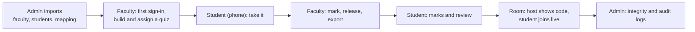

# Testing

OpenQZ is tested at five layers. CI runs all of them on every pull request; a red check blocks the merge.

| Layer | Tool | Where | Count (2026-11-08) |
| --- | --- | --- | --- |
| Backend unit + API | pytest, httpx | `backend/tests/` | 118 tests, 91% line coverage (CI gate: 85%), about 5 minutes |
| Frontend unit | Vitest, Testing Library, happy-dom | `frontend/src/test/` | 24 tests |
| Browser journeys | Playwright (desktop Chrome + Pixel 7) | `frontend/e2e/` | 37 tests in 11 spec files (19 journeys and feature checks, 11 axe checks including dark mode, 3 guide tests, 4 screen-size tests) x 2 devices: 74 runs, 5 skipped by design (the screen-size tests and one live-game test run on the desktop project only). The password-reset journey also skips locally without Mailpit or email, but fails in CI. |
| Accessibility | axe-core in Playwright (WCAG 2.1 AA) | `frontend/e2e/a11y.spec.ts` | landing page, login, student home, join page, create dialog with class picker, faculty library, faculty home (and its quick-create tile); in **dark mode** again: landing page, login, student home, join, faculty home, library, reports, an assignment report, the editor, and the admin dashboard, users, sections, imports and audit log |
| Load | k6 | `tests/load/student-exam.js` | see [performance.md](performance.md) |
| Security | OWASP ZAP baseline, pip-audit, pnpm audit | CI + `docs/reports/` | see [security.md](security.md) |

## Running them

```bash
# backend (uses the openqz_test database in the dev stack)
docker compose -f compose.yaml -f compose.dev.yaml run --rm --no-deps migrate pytest --cov=app
docker compose -f compose.yaml -f compose.dev.yaml run --rm --no-deps migrate sh -c "ruff check . && ruff format --check . && mypy app"

# frontend
cd frontend && pnpm lint && pnpm typecheck && pnpm test

# browser journeys: the dev stack must be running and seeded
bash scripts/seed_demo.sh http://localhost:8088
cd frontend && pnpm exec playwright install chromium && pnpm test:e2e
```

Browser journeys read `E2E_BASE_URL` (default `http://localhost:8088`), `E2E_ADMIN_EMAIL` / `E2E_ADMIN_PASSWORD`, and the test accounts created by the seed script (`faculty@openqz.dev`, `student@openqz.dev`). The password-reset journey reads real emails from Mailpit (`E2E_MAILPIT_URL`, default `http://localhost:8025`) and skips itself when Mailpit is not running.

## What the tests cover

**Backend** (`backend/tests/`)

| File | Covers |
| --- | --- |
| `test_auth.py` | email login (case-insensitive), lockout, refresh rotation and reuse detection, logout, forced password change, RBAC |
| `test_google.py` | Google ID token checks: signature, audience, issuer, expiry, verified email, domain allow-list, unknown email, account linking, temp password cancelled |
| `test_admin.py` | users, password reset, deactivate, departments / sections / subjects / faculty mapping |
| `test_imports.py` | header aliases, row errors (missing, invalid, duplicate USN or email, email owned by someone else), XLSX, manual column mapping, idempotent re-import, credential PDF |
| `test_grading.py` | every question type, partial credit, blank alternatives, case sensitivity, key never leaks |
| `test_activities.py` | editor validation, reorder, apply-to-all, duplicate, permissions, full teach / attempt / grade / review loop, release modes, activity timer, sweeper, question timers and linear mode, violations auto-submit, windows / late / unlimited attempts, shuffle, polls, flashcards, image sniffing |
| `test_extras.py` | rubrics, forgot / reset password, throttling, email notifications, audit log, class context (department locked, sections taught only), Excel export contents |
| `test_integrity.py` | integrity event ingest and listing |
| `test_unblock.py` | unblock reopens only submit-closed answers, gives blocked time back, resets warnings, audit entry, report flags; refused for manual submits, newer attempts, students and other teachers |
| `test_rooms.py` | hosting a room, preview and join by code, wrong / closed / rotated codes, start window, join rate limit (429), club rules (rooms only, no classes), admin creates club accounts |
| `test_admin_data.py` | admin deletes for good (person, activity, assignment results): impact preview, name typed out, password again, wrong-password lock (429), no self-delete, cascades, audit entries, other roles refused |
| `test_org_delete.py` | admin deletes departments, sections and subjects: admin only, impact preview, section refused while its work has attempts, department only when empty, subject takes its teacher mappings, audit entries |
| `test_features.py` | user details, several departments, student section; scheduled start (not started, emails once); instructions; admin statistics and CSV / Excel export; API docs closed in production; reset rate limit; questions locked after a start; integrity events per teacher; new deadline reaches running attempts; key hidden while a blocked student may be let back in; resume after unpublish; same-name live players; cross-origin headers and strict CORS |

**Browser** (`frontend/e2e/`)

| Spec | Journey |
| --- | --- |
| `features.spec.ts` | scheduled activity shows as not started and instructions are read before starting; join code on the sign-in page; admin adds a teacher in two departments and sees the statistics (Excel download); question timer moves on by itself; other browsers are asked to switch; custom time on the clock and the dark-mode answer box; admin deletes a person for good (wrong password refused); admin changes the correct answer with the Correct button and the report shows it; admin deletes a section, a subject and a department, each asked twice (a department with sections is refused) |
| `journeys.spec.ts` | admin dashboard / users / imports; student first sign-in with forced password change; wrong password message |
| `quiz-loop.spec.ts` | teacher creates from the type grid and picks a class, builds MCQ + True/False + open question with rubric, assigns (class pre-selected); student on a phone gets a tab-switch warning, answers with tap and keyboard, sees instant feedback, submits; teacher grades by rubric, downloads Excel; student sees marks per criterion |
| `rooms.spec.ts` | faculty hosts a room (code, QR); a student from another class tries a wrong code, joins and finishes on a phone; live joined / finished count; stop new joins turns a late student away; a club organiser creates (no class picker) and hosts a room |
| `fullscreen.spec.ts` | leaving full screen gives a warning and hides the questions until the student presses Enter full screen |
| `unblock.spec.ts` | student hits the warning limit, teacher unblocks with extra minutes from the report, the waiting student continues |
| `password-reset.spec.ts` | forgot password email via Mailpit, reset, sign in, link is single use |
| `live.spec.ts` | a live game across three browsers: the teacher starts it from the share dialog (guests allowed), a signed-in student enters the code in the normal join box (forwarded to the live game), a guest joins from `/live` with a nickname; the phones show only the answer tiles; automatic reveal when everyone answered; Correct / Not this time on the phones; leaderboard, next question, podium (1st and 2nd place), results page; axe on the lobby, the guest join page and the tiles |
| `responsive.spec.ts` | 18 screens (landing page, sign-in, every admin page, faculty home, library, reports, editor, report, student home, join, quiz player, review) at 320, 375, 768, 1024, 1366, 1920 and 2560 px: no page may be wider than the window; failures name the elements that stick out. On the admin pages and the Reports list, tables must also fit without scrolling inside their own box. The player is loaded once and resized, because reloads count as warnings. |
| `guides.spec.ts` | the student, faculty and admin guides open without signing in, draw their Mermaid flow diagrams under the site CSP with no console errors, and do not scroll sideways |
| `a11y.spec.ts` | no serious or critical WCAG 2.1 AA violations |

## Walkthrough recordings

`node scripts/record_walkthrough.mjs` drives the real UI and records one WebM clip per scene, with captions and a visible pointer, into `recordings/<date-time>/` (git-ignored), plus `index.html` to play them in order. Each run imports a new teacher and three students into a new CSE Sem 5 section, so it can be repeated. Scenes: admin imports, faculty builds and assigns, student takes the quiz on a phone, marking and releasing, student review, a live join-code room (teacher and student recorded side by side), admin logs. Full screen is simulated in the recording browser (real full screen shrinks the emulated phone screen in the video). The demo users it creates stay in the database.

**One narrated video.** Three more steps turn the clips into a single film with title cards, a voice-over and background music:

```bash
pip install edge-tts
python scripts/walkthrough_voice_online.py recordings/<date-time>     # realistic online voice (Microsoft Edge neural, free)
node scripts/make_walkthrough_video.mjs recordings/<date-time>        # -> OpenQZ-walkthrough.mp4, 1920x1080
```

The narration lives in `scripts/walkthrough_narration.json` (one text per scene, plus the voice). The default voice is `en-IN-NeerjaExpressiveNeural`; pass another as the second argument (`edge-tts --list-voices`). The text is sent to Microsoft's speech service. Offline alternative: `powershell -File scripts/walkthrough_voice.ps1 -OutDir recordings/<date-time>` (Windows voices, more robotic). The builder plays the clips in the browser engine onto a canvas, adds the voice and an original generated music track that dips under the voice, and records it in real time (about as long as the video), so no video editor is needed.



## Conventions

- Browser specs build their own class, faculty and student with `seedClass()` from `e2e/helpers.ts`.
- Tests create their own data with unique names; never depend on order between test files.
- Backend tests truncate every table after each test.
- Every bug fix comes with a test that fails without the fix.
